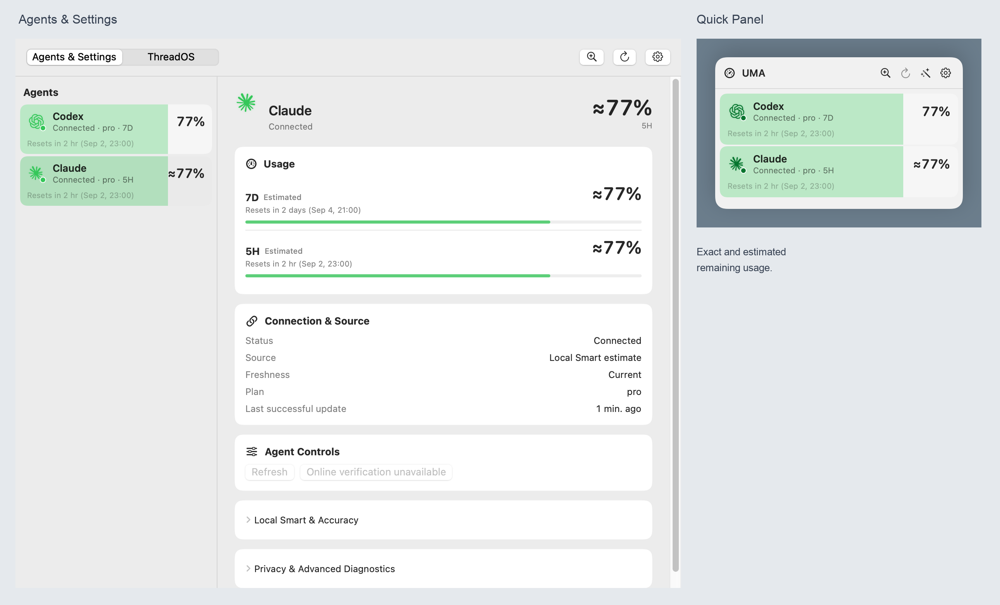
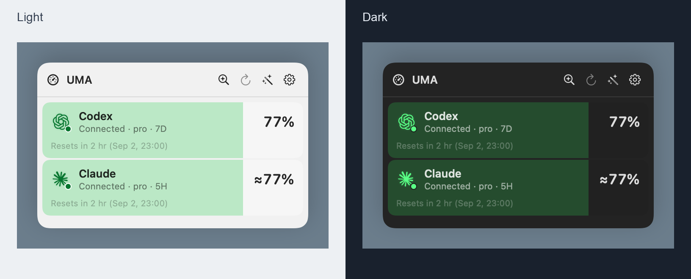
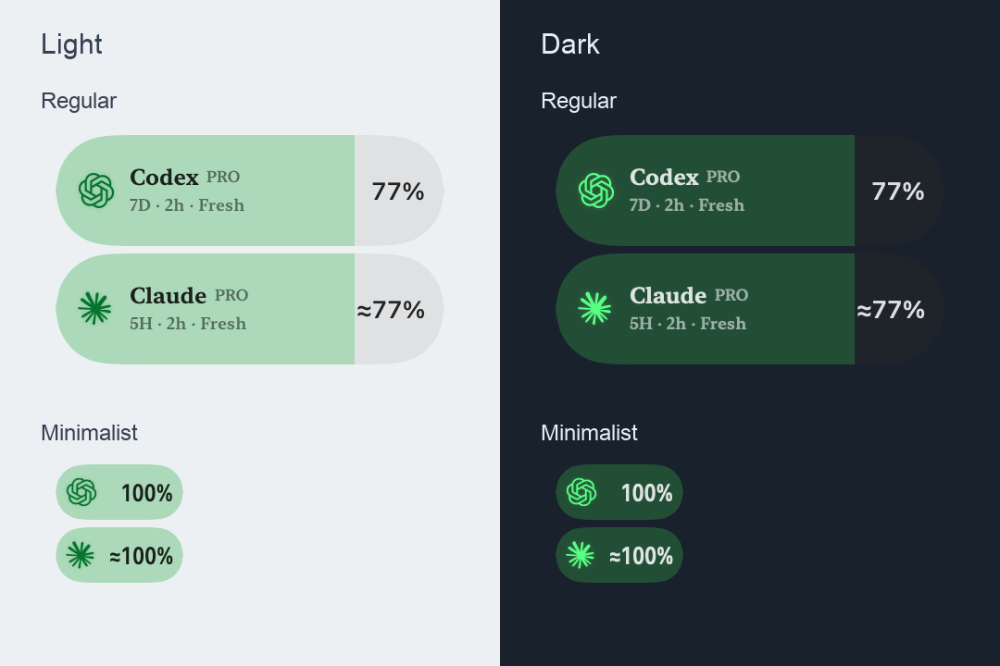
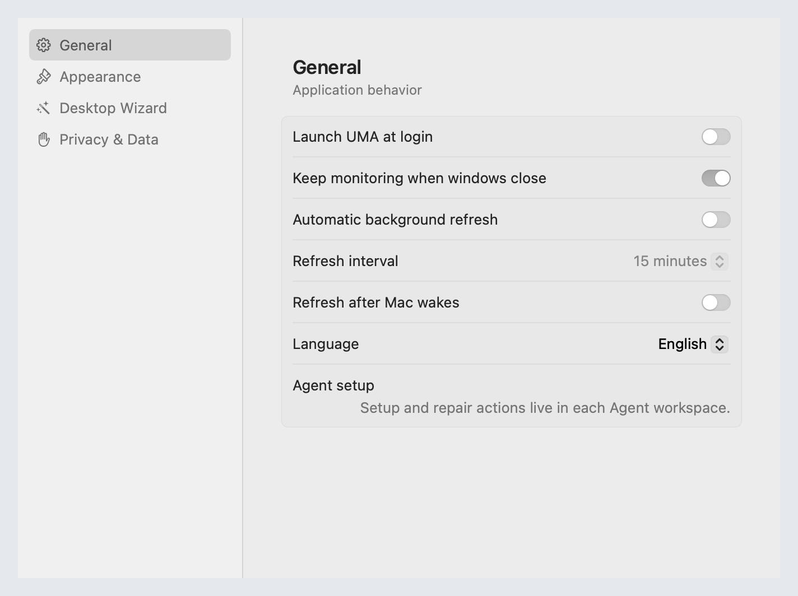
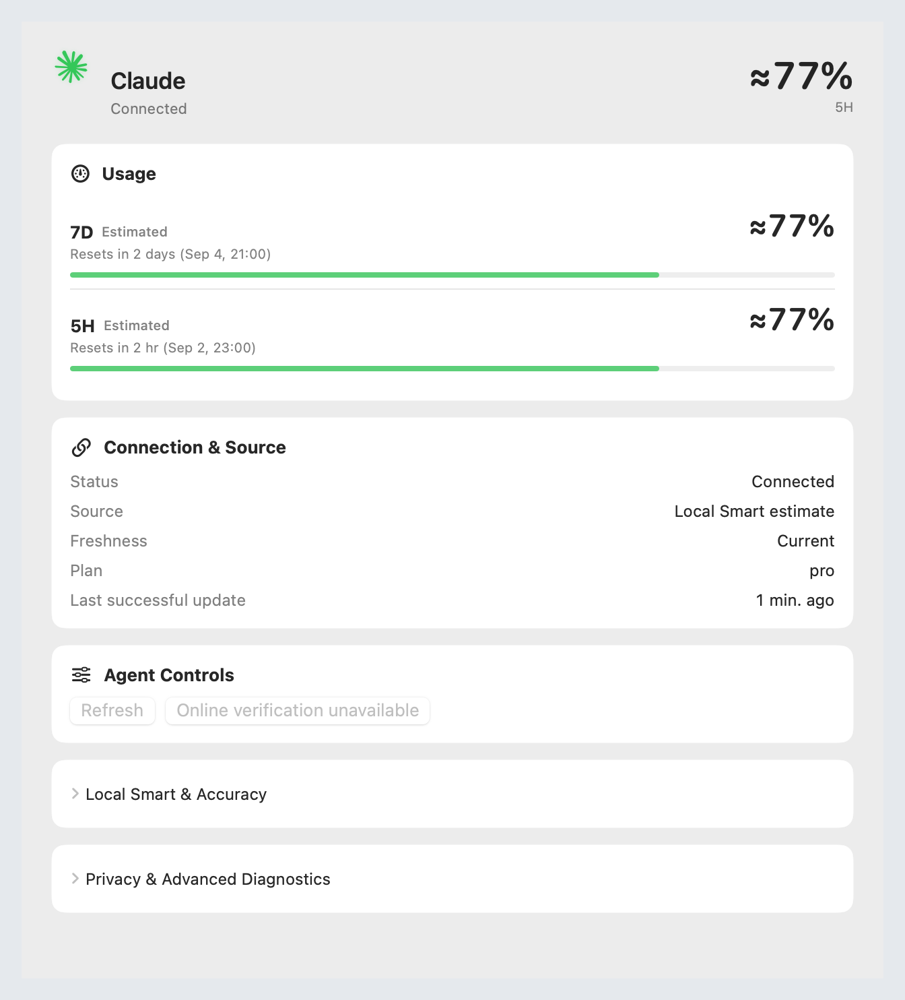

<p align="center">
  
</p>
<h1 align="center">UMA</h1>
<p align="center"><strong>Keep your remaining AI coding quota in sight.</strong><br>原生 macOS AI 编程 Agent 用量与额度监控 · Local-first monitoring for Codex and Claude</p>
<p align="center">
  <a href="https://github.com/ShaoJHe-SilkRoad/UMA/releases/download/v0.14.0/UMA-0.14.0-build2026090504.zip"><strong>Download UMA 0.14.0</strong></a>
  · macOS 14+ · Apple Silicon / arm64<br>
  Developer ID signed · Apple notarized · build 2026090504
</p>
<p align="center"><a href="#中文">中文</a> · <a href="#english">English</a> · <a href="https://github.com/ShaoJHe-SilkRoad/UMA/releases/tag/v0.14.0">Release notes</a></p>

<p align="center">
  
</p>

<p align="center"><sub>真实生产组件，脱敏示例数据 · Production components with sanitized example data</sub></p>

### 看见 UMA · Meet UMA

<table>
<tr>
<td width="50%"><strong>Quick Panel · 快速查看与操作</strong><br></td>
<td width="50%"><strong>Desktop Wizard · 桌面常驻</strong><br></td>
</tr>
<tr>
<td width="50%"><strong>Global Settings · 全局设置</strong><br></td>
<td width="50%"><strong>Agent Workspace · Agent 详情</strong><br></td>
</tr>
</table>

## 中文

UMA 是原生 macOS AI 编程 Agent 用量与额度监控应用。它将**还剩多少、何时重置、数据是否新鲜**放在容易看到的位置，当前正式支持 **Codex 与 Claude**。需要快速确认时打开菜单栏；需要查看来源或连接设置时进入主窗口；也可以让 Desktop Wizard 常驻桌面。

### 0.14 带来了什么

0.14 将早期菜单栏工具扩展为四个共享状态的界面：以 Agent 为中心的主窗口、紧凑 Quick Panel、独立全局设置，以及 Regular / Minimalist 桌面视图。真实 Agent Logo、整行剩余量填充与明暗外观，让额度与状态更容易区分。

### 四个界面，一个操作模型

| 界面 | 用途 |
| --- | --- |
| **Quick Panel** | 快速查看当前可用 Agent 的剩余额度与重置时间；提供 **Open UMA、Scan、Refresh、Desktop Wizard、Settings**。这里用于快速查看和操作，完整连接设置在主窗口。 |
| **Main · Agents & Settings** | 左侧选择 Agent，右侧查看额度窗口、重置时间、精确／估算／不可用状态、连接、来源、数据新鲜度与最近成功更新时间。可靠时显示计划信息，支持对应的刷新／连接／重新连接／断开操作；有真实来源时显示使用量、任务或费用数据。 |
| **Global Settings** | **General、Appearance、Desktop Wizard、Privacy & Data** 管理全局行为。所有设置入口打开同一个窗口；Provider 专属设置在所选 Agent 的工作区。 |
| **Desktop Wizard** | **Regular、Minimalist、Automatic** 密度、**Always on Top**、Light/Dark、真实 Agent Logo 与随状态变化的发光效果。紧凑数字布局保留 `≈`，包括 `≈100%`。 |

### 百分比始终表示「剩余」

| 显示 | 含义 |
| --- | --- |
| `77%` | 精确剩余 77% |
| `≈90%` | 估算剩余约 90% |
| `∞` | 仅当数据源明确报告无限量 |
| `—` | 缺失、不可用或不支持 |

**缺失不等于 0%，100% 不等于无限量。** 紧凑 Agent 行与 Wizard 胶囊使用从左至右的全高度比例填充：填充越多，剩余越多；不是底部细线，也不是已使用比例。没有有效百分比时不虚构填充。详情工作区则保留常规额度条。

低剩余额度可按已知 Provider／计划规则显示红色；**连接状态与额度警示是不同信息**。百分比与 credits 不做虚假的跨单位换算。

### Codex 与 Claude

**Codex** 复用本机已有登录环境，通过受支持的本地来源读取额度与允许的汇总使用元数据。连接由应用统一管理；打开、关闭不同界面不会各自创建或销毁一套连接。默认关闭普通窗口后仍继续监控，用户可以在设置中关闭这一行为。

**Claude** 保持三个独立概念：

1. **Claude Code statusLine**：在支持的 Claude Code 环境中读取结构化本地用量状态。
2. **Claude Desktop Local Smart**：仅在来源满足条件时提供估算；过期或不支持是有效结果，估算始终保留 `≈`。
3. **Accuracy Sync**：用户明确触发的一次性精度同步，**不是持续 Safari 轮询**。

### 共享状态，诚实呈现新鲜度

Quick Panel、主窗口与 Wizard 读取同一份应用状态，全局偏好也只有一个来源。关闭界面不自动等于断开连接，缓存重新显示也不等于刚获得实时数据。**连接是否正常、数据是否新鲜、数值是否精确**分别呈现。启用唤醒刷新后，由应用统一触发受控刷新，不会自动触发 Accuracy Sync。

### 隐私

UMA 优先在本机处理用量元数据。产品状态与诊断通过受限字段投影和清理边界，设计上不保留提示词、回复、聊天、凭据、cookies、认证 tokens、原始 DOM、无关浏览器内容，以及不必要的账户身份或账单正文。Accuracy Sync 需要显式操作，不引入持续浏览器监控。

### 当前支持

| 项目 | UMA 0.14 |
| --- | --- |
| Codex | **正式支持** |
| Claude | **正式支持**，来源与精度按上述三种方式区分 |
| WorkBuddy | **休眠／当前产品未启用**；Logo 或兼容资源不代表运行支持 |
| Google Antigravity | **不属于当前正式支持集**；缺失或不可用时不显示为活动 Agent |
| ThreadOS | 保留未来入口，0.14 中**没有运行活动** |

### 下载与安装

**[下载 UMA 0.14.0 · build 2026090504](https://github.com/ShaoJHe-SilkRoad/UMA/releases/download/v0.14.0/UMA-0.14.0-build2026090504.zip)** · [版本说明](https://github.com/ShaoJHe-SilkRoad/UMA/releases/tag/v0.14.0)

需要 **macOS 14+ 与 Apple Silicon**，以及对应来源需要的本机应用／CLI 和登录状态。

1. 下载并解压 ZIP。
2. 将 `UMA.app` 移入稳定的 Applications 位置。
3. 正常启动 UMA，在所选 Agent 工作区完成可用的连接操作。

发布包已完成 Developer ID 签名、Hardened Runtime、安全时间戳、Apple 公证、stapling 与 Gatekeeper 验证，无需关闭 macOS 安全保护。

### 开发

安装带有 Swift 6 支持的 Xcode 后，可先编译而不启动应用：

```bash
swift build --product CodexUsageMonitor
```

这仅编译源码，不是已签名发布包的生成流程。应用界面、图标与辅助程序的完整打包另有专用流程；请勿将开发构建当作正式发行版。

### 0.15 计划

以下是两条并行的**计划／开发方向，尚未随 0.14 发布**，没有承诺发布日期：

- **Windows 支持**：原生 Windows UMA。
- **UMA × ThreadOS × Sectorium**：macOS 操作生态集成，具体能力仍待后续开发。

### 发布完整性

[SHA-256 校验值](https://github.com/ShaoJHe-SilkRoad/UMA/releases/download/v0.14.0/HASHES.txt) · [延期兼容性 QA 说明](https://github.com/ShaoJHe-SilkRoad/UMA/releases/download/v0.14.0/DEFERRED-QA.md)

部分扩展兼容性验证由 Founder 决定延期至发布后／外部测试；这些项目仍记录为延期，不代表已经通过。

---

## English

UMA is a native macOS usage and quota monitor for AI coding agents. Keep **what remains, when it resets, and how fresh the data is** close at hand, with active support for **Codex and Claude**. Glance from the menu bar, open the Main window for sources and connection settings, or keep Desktop Wizard on your desktop.

### What changed in 0.14

Version 0.14 expands the earlier menu-bar utility into four surfaces sharing the same state: an Agent-centered Main window, compact Quick Panel, dedicated global Settings, and Regular / Minimalist desktop views. Real agent logos, solid remaining-usage fills, and Light/Dark appearances make quota and connection status easier to distinguish.

### Four surfaces, one workflow

| Surface | Purpose |
| --- | --- |
| **Quick Panel** | Current eligible agents, remaining quota, and reset times, with **Open UMA, Scan, Refresh, Desktop Wizard, and Settings** actions. Built for quick checks and actions; full connection setup lives in Main. |
| **Main · Agents & Settings** | Select an Agent on the left; inspect quota windows, resets, exact/estimated/unavailable values, connection, source, freshness, and last successful update on the right. Shows plan information when reliable, applicable refresh/connect/reconnect/disconnect actions, and usage/task/cost data only when genuinely available. |
| **Global Settings** | **General, Appearance, Desktop Wizard, and Privacy & Data** control app-wide behavior. Every Settings entry opens the same window; provider-specific setup belongs in the selected Agent workspace. |
| **Desktop Wizard** | **Regular, Minimalist, Automatic**, **Always on Top**, Light/Dark, real agent logos, and state-aware glow. Stable compact percentage layout preserves `≈`, including `≈100%`. |

### Percentages always mean remaining

| Display | Meaning |
| --- | --- |
| `77%` | Exactly 77% remaining |
| `≈90%` | Approximately 90% remaining, estimated |
| `∞` | Only when the source explicitly reports unlimited usage |
| `—` | Missing, unavailable, or unsupported |

**Missing is not 0%; 100% is not infinity.** Compact Agent rows and Wizard pills use full-height proportional fill from left to right: more fill means more remaining. This is neither a thin bottom rail nor a used-percentage display. No valid percentage means no invented fill. Detailed workspace quota modules keep conventional progress bars.

Low remaining quota may turn red under known provider/plan rules. **Connection state and quota severity communicate different things.** Percentages and credits are not artificially converted into one unit.

### Codex and Claude

**Codex** reuses the existing local signed-in environment through supported local sources for quota and admitted aggregate usage metadata. One application-owned connection serves the UI; surfaces do not each create or destroy provider sessions. Monitoring continues after ordinary windows close by default, and users can explicitly disable that behavior in Settings.

**Claude** keeps three independent concepts:

1. **Claude Code statusLine** — structured local usage state in supported Claude Code environments.
2. **Claude Desktop Local Smart** — estimates only when the source qualifies; stale or unsupported are valid outcomes, and estimates retain `≈`.
3. **Accuracy Sync** — an explicit one-shot precision action, **not continuous Safari polling**.

### Shared state, honest freshness

Quick Panel, Main, and Wizard read the same application state, with one shared source of preferences. Closing a surface does not automatically mean disconnecting, and redisplaying a cache does not make it a fresh observation. **Connection, freshness, and precision** remain separate. When wake refresh is enabled, the application coordinates bounded refresh without automatically triggering Accuracy Sync.

### Privacy

UMA processes usage metadata locally first. Product state and diagnostics pass through restricted field projections and sanitization boundaries. It is designed not to retain prompts, responses, chats, credentials, cookies, authentication tokens, raw DOM, unrelated browser content, or unnecessary account-identity and billing-history bodies. Accuracy Sync requires an explicit action and does not introduce continuous browser monitoring.

### Current support

| Component | UMA 0.14 |
| --- | --- |
| Codex | **Active support** |
| Claude | **Active support**, with the three distinct source/precision paths above |
| WorkBuddy | **Dormant / not active in the current product**; logos or compatibility assets do not imply runtime support |
| Google Antigravity | **Outside the current active support set**; absent/unavailable installations do not appear as active agents |
| ThreadOS | Reserved future destination; **zero runtime activity** in 0.14 |

### Download and install

**[Download UMA 0.14.0 · build 2026090504](https://github.com/ShaoJHe-SilkRoad/UMA/releases/download/v0.14.0/UMA-0.14.0-build2026090504.zip)** · [Release notes](https://github.com/ShaoJHe-SilkRoad/UMA/releases/tag/v0.14.0)

Requires **macOS 14+ and Apple Silicon**, plus the local app/CLI and signed-in state required by the corresponding provider source.

1. Download and extract the ZIP.
2. Move `UMA.app` to a stable Applications location.
3. Launch normally and use the available connection actions in the selected Agent workspace.

The release is Developer ID signed with Hardened Runtime and a secure timestamp, Apple-notarized, stapled, and Gatekeeper-validated. There is no need to disable macOS security protections.

### Development

With Xcode and Swift 6 support installed, compile without launching the app:

```bash
swift build --product CodexUsageMonitor
```

This compiles source; it does not produce the signed distribution. Full app resources and helpers require the dedicated packaging flow. A development build is not a release package.

### 0.15 roadmap

Two parallel **planned / in-development directions, not shipped in 0.14**, with no promised release dates:

- **Windows support** — native Windows UMA.
- **UMA × ThreadOS × Sectorium** — macOS operational ecosystem integration, with capabilities to be developed in future work.

### Release integrity

[SHA-256 hashes](https://github.com/ShaoJHe-SilkRoad/UMA/releases/download/v0.14.0/HASHES.txt) · [Deferred compatibility QA](https://github.com/ShaoJHe-SilkRoad/UMA/releases/download/v0.14.0/DEFERRED-QA.md)

Some extended compatibility qualification was deferred by the Founder to post-release / external testing. Those items remain documented as deferred, not passed.
