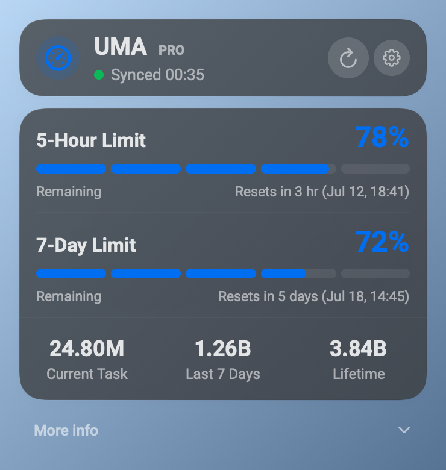
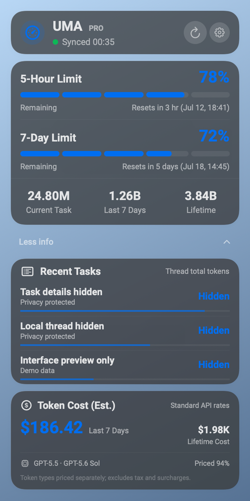
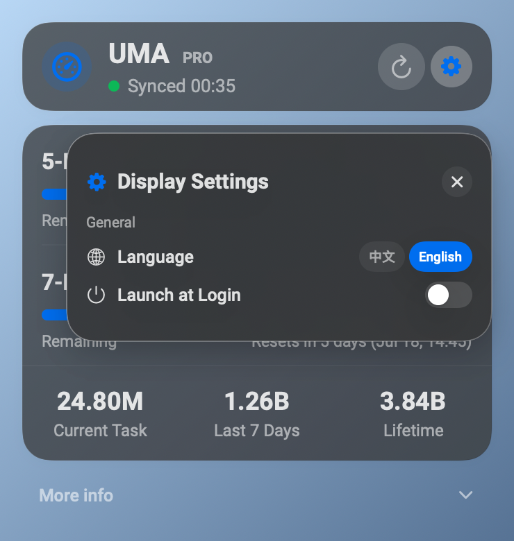

# UMA

**Usage Monitor Altoget**

> UMA 0.9 is a development preview of a local-first macOS menu-bar usage monitor. The current Codex connector and interface have passed functional, visual, packaging, and bounded stability validation. Extended long-duration debugging remains scheduled after this repository publication.

English · [简体中文](#简体中文)

## Overview

UMA is a native macOS menu-bar usage monitor designed around provider-specific
connectors for AI coding agents. The current implemented connector is Codex.
Future providers are architectural possibilities, not implemented features.

## Current features

- One menu-bar app, one status item, and one Codex connector.
- Real Codex rate-limit and account-usage data, including the effective
  seven-day quota.
- An authoritative five-hour unlimited state when Codex supplies one.
- Provider notifications where supported, plus 15-second visible-panel and
  30-second hidden-panel refresh fallbacks.
- Manual **Refresh**, reconnect, and owned-child recovery.
- Local activity and estimated token cost behind **More info / Less info**.
  Estimated cost is an API-equivalent estimate, not an account bill.
- English and Simplified Chinese interfaces.
- A native glass interface supporting Light, Dark, Reduce Transparency, and
  Increase Contrast appearances.
- Roboto for Latin text and numbers, with explicit PingFang SC fallback for
  Simplified Chinese.
- Local-first data handling.

## Screenshots

<p align="center">
  
  
</p>

<p align="center">
  
  
</p>

Screenshots use illustrative sanitized preview data.

## Requirements

- macOS 14 or later.
- `/Applications/Codex.app` installed and signed in.
- For source builds only: Xcode with Swift 6 support.

## Installation

There is no formal notarized UMA release yet. For local development:

```bash
git clone https://github.com/ShaoJHe-SilkRoad/UMA.git
cd UMA
./script/build_and_run.sh
```

The script builds, ad-hoc signs, and launches `dist/UMA.app`. UMA is a
menu-bar-only app, so no Dock icon is expected. A friend-preview installation
is possible only when a separately built app bundle is shared; this repository
does not present an obsolete upstream Release as an UMA download.

## Build

Build and launch:

```bash
./script/build_and_run.sh
```

Build, launch, and verify the process:

```bash
./script/build_and_run.sh --verify
```

Current output:

```text
dist/UMA.app
```

The public app name is UMA. The internal Swift package, target, module, and
executable remain `CodexUsageMonitor` for compatibility.

## Data sources

**Account and provider data:** UMA talks to the local Codex app-server to read
account limits, account usage, and other provider-reported data.

**Local activity:** UMA reads only allowlisted local token/model metadata for
activity summaries and a local usage/cost estimate. The estimate is not an
account bill.

## Privacy

- No separate API key entry and no plaintext credential collection.
- No conversation-content retention.
- No account identity is committed to this repository.
- No UMA-owned remote telemetry.
- Local state remains local unless the user manually exports it.

## Development status

This repository contains **UMA 0.9 Development Preview**. The founder has
accepted it as stable enough for collaborative development, but it is not a
final release. The four-hour long-debug is scheduled after repository
publication. UMA is not notarized and is not distributed through the Mac App
Store.

## Collaboration

Clone the canonical repository, create a feature branch, make focused commits,
push the feature branch, and open a pull request to `main`. Run the relevant
tests before requesting review. Never commit credentials, local Codex state,
ledgers, logs, app bundles, or other generated/private artifacts.

See [CONTRIBUTING.md](CONTRIBUTING.md) and
[docs/COLLABORATION.md](docs/COLLABORATION.md).

## Attribution

UMA was originally derived from
[CodexUsageMonitor by ower93](https://github.com/ower93/CodexUsageMonitor).

UMA development and substantial modifications:
[ShaoJHe-SilkRoad/UMA](https://github.com/ShaoJHe-SilkRoad/UMA).

## License status

No repository-wide software license was found in the current repository or the
inspected upstream repository. Public visibility alone does not make the
project open source, and this README does not infer permissions that have not
been granted. The bundled Roboto files retain the SIL Open Font License 1.1 and
provenance under `Sources/CodexUsageUI/Resources/Fonts/Roboto/`.

Compatibility details are documented in
[docs/COMPATIBILITY.md](docs/COMPATIBILITY.md).

---

## 简体中文

### 项目简介

UMA（Usage Monitor Altoget）是一款原生 macOS 菜单栏用量监视器，采用面向
不同 AI 编码代理提供方的连接器架构。当前实际实现的连接器仅为 Codex；未来
可能支持的提供方不属于当前已实现功能。

### 当前功能

- 一个菜单栏应用、一个状态项和一个 Codex 连接器；
- 读取真实 Codex 限额与账户用量，包括有效七天限额；
- 当 Codex 明确提供时，显示权威的五小时无限状态；
- 在支持时接收提供方通知，并提供面板可见 15 秒、隐藏 30 秒的刷新回退；
- 手动“刷新”、重新连接和受管子进程恢复；
- 在“更多信息 / 更少信息”中显示本机活动与 Token 费用估算；估算不是账户账单；
- 英文和简体中文界面；
- 原生玻璃界面，支持浅色、深色、降低透明度和增强对比度；
- 拉丁文字与数字使用 Roboto，简体中文明确回退到 PingFang SC；
- 数据优先在本机处理。

### 界面预览

上方截图使用经过清理的说明性预览数据，不包含真实账户身份或个人用量。

### 运行要求

- macOS 14 或更高版本；
- 已安装 `/Applications/Codex.app` 并已登录；
- 仅从源代码构建时需要支持 Swift 6 的 Xcode。

### 安装

目前没有正式的已公证 UMA Release。本机开发可执行：

```bash
git clone https://github.com/ShaoJHe-SilkRoad/UMA.git
cd UMA
./script/build_and_run.sh
```

脚本会构建、临时签名并启动 `dist/UMA.app`。UMA 仅驻留在菜单栏，不出现 Dock
图标属于正常行为。只有另行分享已构建的 app bundle 时，朋友才能安装预览版；
本文不会把旧上游 Release 当作当前 UMA 下载。

### 构建

```bash
./script/build_and_run.sh
./script/build_and_run.sh --verify
```

当前输出为 `dist/UMA.app`。用户可见名称为 UMA；为兼容现有本机数据，内部
Swift 包、Target、Module 和可执行文件仍使用 `CodexUsageMonitor`。

### 数据来源

**账户与提供方数据：** UMA 通过本机 Codex app-server 读取账户限额、账户用量
和其他由提供方报告的数据。

**本机活动：** UMA 仅读取允许列表中的本机 Token / 模型元数据，用于活动摘要
和本机用量、费用估算；该估算不是账户账单。

### 隐私

- 无需单独输入 API Key，也不收集明文凭据；
- 不保留对话内容；
- 仓库不提交账户身份；
- UMA 不运营远程遥测；
- 除非用户手动导出，本机状态始终保留在本机。

### 开发状态

当前版本为 **UMA 0.9 Development Preview**。创始人已认可其稳定性足以进行
协作开发，但它不是最终版本。四小时长时间调试安排在仓库发布之后。UMA 尚未
公证，也未通过 Mac App Store 分发。

### 协作

请克隆规范仓库，创建功能分支，提交范围明确的改动，推送功能分支，并向
`main` 发起 Pull Request。请求评审前应运行相关测试。不得提交凭据、本机
Codex 状态、费用账本、日志、app bundle 或其他生成/私有文件。

详见 [CONTRIBUTING.md](CONTRIBUTING.md) 与
[docs/COLLABORATION.md](docs/COLLABORATION.md)。

### 致谢

UMA 最初派生自
[ower93 的 CodexUsageMonitor](https://github.com/ower93/CodexUsageMonitor)。

UMA 的开发与重大修改位于
[ShaoJHe-SilkRoad/UMA](https://github.com/ShaoJHe-SilkRoad/UMA)。

### 许可状态

在当前仓库及已检查的上游仓库中均未找到覆盖整个软件仓库的许可证。仓库公开
不等于自动成为开源项目，本文不会推断未被授予的权限。随附 Roboto 文件继续
遵循 SIL Open Font License 1.1，其来源记录位于
`Sources/CodexUsageUI/Resources/Fonts/Roboto/`。
