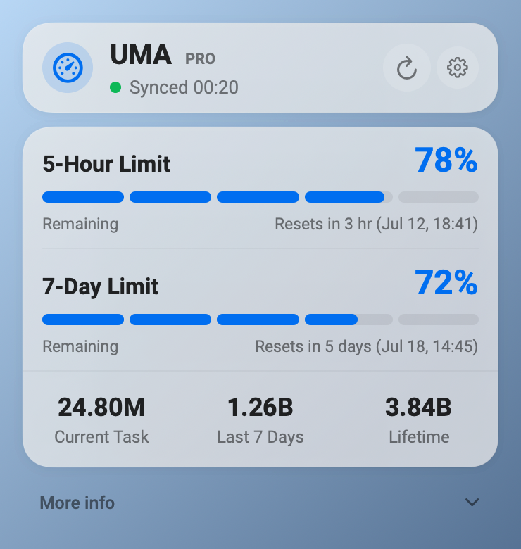
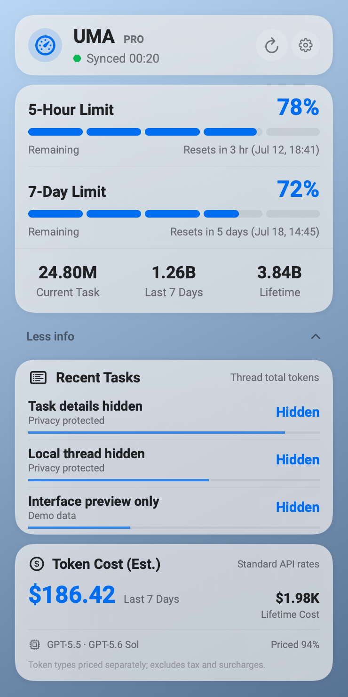

<p align="center">
  
</p>

# UMA

## Usage Monitor Altoget

> **UMA 0.9 is a development preview. The current Codex connector and user interface have passed bounded functional and visual validation. Extended long-duration debugging is scheduled after this source push.**

English · [简体中文](#简体中文)

<p align="center">
  
  
</p>

<p align="center"><em>Illustrative preview data generated locally by PreviewRendererTool.</em></p>

## Overview

UMA is a native macOS menu-bar usage monitor designed to present usage from AI
coding agents through provider-specific local connectors.

The production-ready connector scope for this preview is Codex:

- Codex account limits and account token summaries.
- Local Codex activity and estimated API-equivalent cost.
- A connector architecture for future providers. Unsupported agents are not
  presented as implemented.

## Current features

- Native AppKit and SwiftUI macOS menu-bar application.
- One menu-bar status item and one local Codex connector.
- Real Codex account usage with the effective seven-day quota.
- Authoritative unlimited five-hour state when the provider supplies it.
- Near-real-time provider notifications where supported.
- Fifteen-second visible-panel and thirty-second hidden-panel refresh fallbacks.
- Manual Refresh, automatic reconnect, and owned-child recovery.
- Local activity and estimated token cost under **More info**.
- English and Simplified Chinese interfaces.
- Native glass presentation with Light, Dark, Reduce Transparency, and Increase
  Contrast support.
- Roboto for Latin and numeric typography with a compatible Chinese fallback.
- Local-first processing. The token-cost value is an estimate, not a bill.

## Requirements

- macOS 14 or later.
- `/Applications/Codex.app` installed.
- Codex signed in.
- Xcode with Swift 6 support is required only when building from source.

## Privacy

- UMA does not ask for a separate API key.
- UMA does not collect plaintext credentials.
- Account usage is requested through the local Codex app-server.
- Local estimates use allowlisted token and model metadata.
- Conversation content is not retained by UMA.
- Data remains local unless the user separately exports it.

## Build

Build, package, sign ad hoc, and launch the local development application:

```bash
./script/build_and_run.sh
```

Verify the local launch:

```bash
./script/build_and_run.sh --verify
```

The user-facing output is:

```text
dist/UMA.app
```

The internal Swift executable and target remain `CodexUsageMonitor` for
compatibility.

Generate the sanitized README previews:

```bash
swift run PreviewRendererTool outputs/UMA-preview-collapsed.png --english
swift run PreviewRendererTool outputs/UMA-preview-expanded.png --english --expanded
```

## Development status

This repository contains **UMA 0.9 Development Preview**. By founder decision,
it is stable enough for current collaborative development. A full four-hour
long-duration debug remains scheduled after this source publication.

This preview is not claimed to be notarized or distributed through the Mac App
Store.

## Collaboration

Use issues and pull requests for collaboration. Prefer this repository as the
single canonical development source.

Do not commit credentials, local cost ledgers, session logs, `.build`, temporary
packages, or screenshots containing identity or account information.

Recommended workflow:

```text
clone ShaoJHe-SilkRoad/UMA
→ create a feature branch
→ push the feature branch
→ open a pull request to main
```

## Technical compatibility

The public product name is UMA, while these legacy identifiers are deliberately
retained to preserve existing local data and reduce migration risk:

- Bundle identifier and preference domain: `com.kevinchen.CodexUsageMonitor`
- Internal Swift package, executable, target, and module names
- Application Support directory:
  `~/Library/Application Support/CodexUsageMonitor`
- Cost ledger:
  `~/Library/Application Support/CodexUsageMonitor/token-cost-ledger.json`
- Existing consent and language preference keys

## Attribution and license status

UMA was originally derived from
[CodexUsageMonitor by ower93](https://github.com/ower93/CodexUsageMonitor).

UMA development and substantial modifications:
[ShaoJHe-SilkRoad/UMA](https://github.com/ShaoJHe-SilkRoad/UMA).

No repository-wide software license was found in either the current repository
or the inspected upstream repository. This README does not infer permissions
that have not been granted and does not describe the repository as open source.
The bundled Roboto font files retain their SIL Open Font License 1.1 and
provenance under `Sources/CodexUsageUI/Resources/Fonts/Roboto`.

---

## 简体中文

### 概览

UMA（Usage Monitor Altoget）是一款原生 macOS 菜单栏用量监视器，通过不同
AI 编码代理对应的本机连接器呈现用量信息。

本开发预览中已达到可用状态的连接器仅限 Codex：

- Codex 账户限额与账户 Token 摘要；
- 本机 Codex 活动与 API 等值费用估算；
- 已预留未来连接器架构，但未实现的代理不会被描述为已支持。

### 当前功能

- 原生 AppKit 与 SwiftUI 菜单栏应用；
- 一个菜单栏状态项和一个本机 Codex 连接器；
- 真实 Codex 账户用量和有效七天限额；
- 当提供方明确返回时，保留权威的五小时无限状态；
- 在支持时接收近实时提供方通知；
- 面板可见时 15 秒、隐藏时 30 秒的刷新回退；
- 手动刷新、自动重连和受管子进程恢复；
- 在“更多信息”中显示本机活动和 Token 费用估算；
- 英文和简体中文；
- 原生玻璃界面，支持浅色、深色、降低透明度和增强对比度；
- 拉丁文字与数字使用 Roboto，中文使用兼容回退字体；
- 数据优先在本机处理。Token 费用仅为估算，并非账单。

### 系统要求

- macOS 14 或更高版本；
- 已安装 `/Applications/Codex.app`；
- Codex 已登录；
- 仅从源代码构建时需要支持 Swift 6 的 Xcode。

### 隐私

- 无需单独输入 API Key；
- 不收集明文凭据；
- 账户用量通过本机 Codex app-server 获取；
- 本机估算只使用允许列表中的 Token 和模型元数据；
- UMA 不保留对话内容；
- 除非用户另行导出，否则数据保留在本机。

### 构建

```bash
./script/build_and_run.sh
```

生成并启动的用户可见应用为：

```text
dist/UMA.app
```

为保持现有偏好、许可状态和费用账本可用，内部
`CodexUsageMonitor` 目标、可执行文件、Bundle ID、偏好域和
Application Support 路径暂时保留。

### 开发状态

当前版本为 **UMA 0.9 Development Preview**。根据创始人决定，它已足够稳定，
可用于当前协作开发。完整的四小时长时间调试安排在本次源代码发布之后。

本预览不声称已经公证，也不声称通过 Mac App Store 分发。

### 协作

请通过 Issue 和 Pull Request 协作。不要提交凭据、本机费用账本、会话日志、
`.build`、临时安装包或包含身份与账户信息的截图。

### 来源与许可状态

UMA 最初派生自
[ower93 的 CodexUsageMonitor](https://github.com/ower93/CodexUsageMonitor)。

UMA 的开发与重大修改位于
[ShaoJHe-SilkRoad/UMA](https://github.com/ShaoJHe-SilkRoad/UMA)。

在当前仓库和已检查的上游仓库中均未找到覆盖整个软件仓库的许可证，因此本文
不会推断未授予的权限，也不会将项目描述为开源。随附 Roboto 字体继续遵循
SIL Open Font License 1.1，并保留其来源记录。
