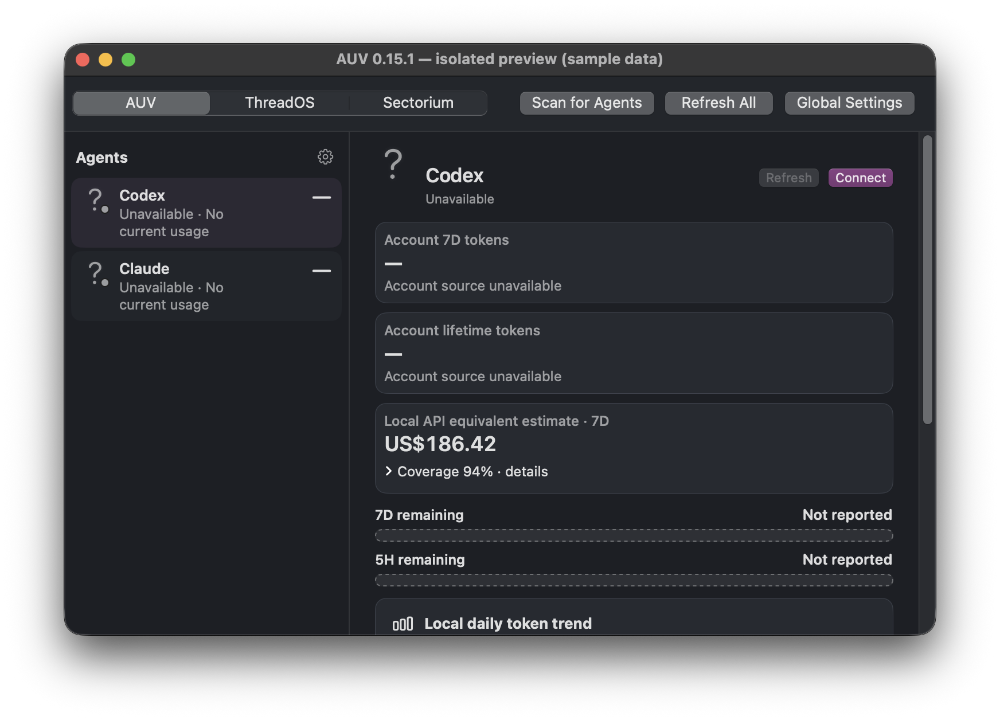
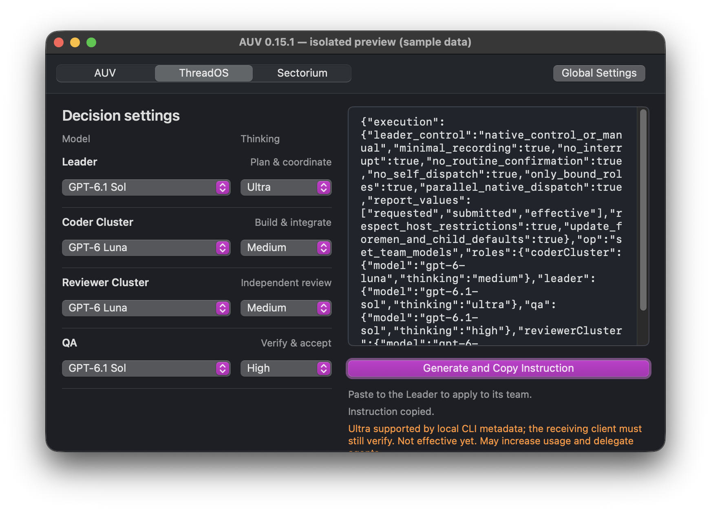

# AUV — Agent Usage Viewer

> **AUV 0.15.1 · build 2026101002.** Formerly UMA; existing settings and technical identities are preserved. See the release assets for the archive checksum and actual signing/notarization record.
> **AUV 0.15.1 · 构建 2026101002。** 原名 UMA，保留原有设置和技术身份。下载哈希及签名／公证状态见发布附件；已测与未测范围见下文。

[中文](#中文) · [English](#english) · [0.15.1 release](https://github.com/ShaoJHe-SilkRoad/UMA/releases/tag/v0.15.1)

AUV was formerly named UMA. The integrated application retains ThreadOS and Sectorium; the repository, `UMA.app` basename and technical identities remain compatible with existing settings.

## 中文

AUV 是原 UMA 的公开名称：**Agent Usage Viewer**。同一个应用包含用量查看、**ThreadOS（线程工）**团队设置与 **Sectorium（分区工）**开发盘管理。

### 功能与动线

- **AUV：**左侧选择代理，查看剩余额度、账户信息和本地用量；保留代理自己的设置入口、菜单栏和桌面助手。未知值保持未知，本地估算与账户额度分开；API 等值估算不等于订阅账单。
- **ThreadOS：**分别设置 Leader、Coder Cluster、Reviewer Cluster、QA 的模型和 Thinking。精确预览后复制一次，粘贴给负责开发目录的 Leader；不在 AUV 选择项目或收件线程，也不自动发送。
- **Sectorium：**物理硬盘与其虚拟开发盘关联显示，提供创建/接纳、启动/停止和安全弹出操作；组件安装、自动挂载偏好、服务观察和磁盘就绪分别报告。APFS 文件镜像不是修改物理分区。
- 中英文、明暗主题、原生键盘路线和既有窗口操作保留。本版不改变存储安全链路，也不新增自动派工。

### ThreadOS 与 Ultra

中文、明亮主题和最小窗口截图待补；这里展示真实英文候选。

1. 进入 ThreadOS，分别选择四个角色的模型与思考档位。
2. 查看完整指令预览，点击“生成并复制指令”。
3. 粘贴给目标 Leader。由它核实自己的开发根和团队绑定，提交受支持的原生参数；Leader 自身若无可用控制，仍须使用原生模型控件。
4. 区分**请求值、提交值、经验证生效值**；复制成功不是模型已切换。

原有 Low / Medium / High / Ex High 保留，新增精确机器值 `ultra`。目录修订 `sol-luna-ultra-20261010.1` 的 GPT-6.1 Sol、GPT-6 Sol、GPT-6 Astra、GPT-5.6 Sol、GPT-5.6 Terra 允许 Ultra；GPT-6 Luna 不允许。应用只读现有本地 CLI 模型元数据，区分支持、不支持及未核实；缺失、离线或过期时可生成目录允许的待核实请求。已知不兼容会阻止生成或选择，保留旧选择，不静默降级。接收客户端还须核验自己的能力。

Ultra 可能增加用量，并在适用宿主中委派额外代理。它不是 Fast，不是另一个模型；复制不会启动推理。本版没有进行真实 Ultra 推理或证明后端生效。

[完整线程工指南](https://shaotinghe.com/threados/) · [接收端兼容说明](docs/releases/0.15.1.md)

### Sectorium：早期开发阶段

> Sectorium 目前处于早期开发阶段。请先独立备份重要数据，并优先使用非关键测试数据评估。异常断连、操作中断或未覆盖故障可能导致数据不可用或损坏；未确认完整安全弹出前，请勿直接拔盘。已有测试不代表所有设备和异常场景均已验证。

**分区工当前候选的原生截图与窗口验收待补。** 不使用旧版或模拟图片代替。

进入 Sectorium 后选择目标物理硬盘。接纳已有开发镜像或在明确位置创建文件型 APFS 镜像，随后启动；停止开发盘与安全弹出整个外接硬盘是不同操作。安装工具不等于创建镜像，启用自动挂载不等于立即挂载。本地系统盘不能进入物理弹出路径。

身份未知、只读、忙碌或部分完成不能当作成功。查看中文状态和可展开诊断；不要删除锁或恢复记录，不强制卸载、不杀进程，不反复点击恢复。磁盘状态与 I/O 读取元数据；AUV 不因此控制其他应用的写入。

本次已检查 AUV 和 ThreadOS 英文暗色隔离窗口及相关源码；分区工窗口、其他语言/主题和最小窗口仍待原生验收。真实设备的创建、接纳、挂载、停止、服务安装/自动触发、安全弹出、加密、断连恢复、睡眠与重启**未在本次实测**。历史成功不替代当前实盘验收。风险和逐项证据范围见[分区工指南](https://shaotinghe.com/sectorium/)。

### 下载与升级

**完整步骤：**[安装、升级、首次使用及回退指南](docs/INSTALLATION.md#中文安装指南)（系统要求、正式下载、哈希、Finder 安装、组件设置与排错）。

macOS 14 或更高；本次可下载构建为 **Apple silicon (arm64)**。从 [0.15.1 正式发布页](https://github.com/ShaoJHe-SilkRoad/UMA/releases/tag/v0.15.1) 下载应用 ZIP 和 SHA-256 文件，核对哈希及该页签名/公证结果。正常退出旧应用后，用解压的 `UMA.app` 替换原应用；建议保留旧应用副本。它显示为 AUV，保留原 bundle ID、偏好键、历史和用户设置。不要清空设置以升级，也不要关闭系统安全检查。

**Sectorium 仍是早期软件：下载/设置前独立备份，优先测试数据；完整安全弹出未确认前不可拔盘。** 安装应用不会自动证明工具安装、自动化服务或磁盘已经就绪。浏览器桥接组件的既有启用和权限边界不变，本版不要求重新授权整个系统。

### 排错与开发

复制失败时选择仍保留；修正不支持的已保存值须由用户明确选择。接收宿主限制应原样报告，不以 ACK 或发送成功冒充生效。存储出现部分失败时保留记录并查诊断，不给出“可以拔线”的假结论。

本版新增聚焦检查通过；旧 Factorium 草稿四项测试在原始基线与候选中均失败，完整检查不是全通过。Founder 已批准当前版本发布；尚未完成的原生窗口检查仍按实际范围列出，不计作通过。

源码检查使用已配置 Xcode 的 SwiftPM；`swift test --disable-sandbox` 是测试，不会安装。Canonical 发布脚本是 `script/package_uma014_rc.py`，要求准确提交/树/分支和干净源码归档。开发启动脚本会构建并运行应用，不应当作只读检查。更多本版范围见[发布说明](docs/releases/0.15.1.md)。

## English

AUV — **Agent Usage Viewer**, formerly UMA — is the same integrated macOS application. Its usage workspace, ThreadOS team configuration and Sectorium development-drive tools retain their existing navigation and technical identity.

### Features and navigation

Select an agent in the left rail for remaining-usage bars, account information, local estimates and that agent's settings. Unknown is not zero; local/API-equivalent estimates are not subscription charges. Existing menu bar, desktop assistant, language, theme and keyboard behavior remain available.

ThreadOS prepares an exact, target-free instruction for four independently selected roles. Choose model/Thinking → inspect preview → copy → paste into the Leader responsible for your development folder. The receiving Leader resolves the bound team; AUV does not send automatically. Requested, submitted and effective-observed values are distinct.

### Ultra capability

Low, Medium, High and Ex High remain unchanged. Ultra uses the exact value `ultra`. Catalog `sol-luna-ultra-20261010.1` permits it for GPT-6.1 Sol, GPT-6 Sol, GPT-6 Astra, GPT-5.6 Sol and GPT-5.6 Terra; not GPT-6 Luna. Read-only local CLI metadata provides client-specific supported/unsupported/unverified states. Missing, stale or offline metadata permits deterministic catalog-supported pending requests. Known incompatibility is blocked while preserving selections, without silently downgrading or changing another role.

The receiver must verify its own client. Ultra may increase usage and delegate additional agents on eligible hosts. It is not Fast, a separate model, or evidence of native activation. No live Ultra inference was run for this release. [ThreadOS guide](https://shaotinghe.com/threados/) · [Ultra compatibility and limits](docs/releases/0.15.1.md).

### Sectorium: early development

> Keep an independent current backup and prefer noncritical test data. Abnormal disconnection, interrupted operations and untested faults may make data unavailable or corrupt it. Do not unplug before the complete intended safe-eject sequence is confirmed. Tests do not establish safety for every device or failure mode.

**Sectorium native screenshot and window validation are pending.** Older or rendered fixtures are not substituted.

Select the intended physical drive and inspect its associated development image. Create/adopt, start/stop and whole-external-drive safe eject have different effects. An APFS file image is not physical repartitioning. Tool installation, automation preference, observed service status and actual disk readiness are separate. Internal disks cannot be physically ejected by this workflow. Unknown identity, occupancy or partial failure is not success. Do not delete locks/journals, force-unmount, kill processes or blindly repeat Resume.

AUV and ThreadOS English/dark isolated windows and relevant source regressions were checked. Sectorium, other language/theme states and minimum-window validation remain pending. This is **not** live create/adopt/mount/stop, service installation/automation, safe ejection, encryption, disconnect recovery, sleep or restart. Historical tests do not verify the current hardware path. [Sectorium guide and tested/not-tested matrix](https://shaotinghe.com/sectorium/).

### Download, upgrade and troubleshooting

**Full instructions:** [Installation, upgrade, first use and rollback](docs/INSTALLATION.md#english-installation-guide), including requirements, download/checksum, Finder steps, component setup and troubleshooting.

Requires macOS 14+; the downloadable build targets Apple silicon (arm64). Download the ZIP and SHA-256 from [0.15.1](https://github.com/ShaoJHe-SilkRoad/UMA/releases/tag/v0.15.1), and inspect its actual signing/notarization record. Quit normally, retain a backup, and replace the application with `UMA.app`. It displays AUV while preserving bundle ID, preference domains, history, helpers and stored choices. Do not clear user data or disable security checks.

**Before installing/configuring early-stage Sectorium, back up independently and use noncritical data. Do not unplug until full safe eject is confirmed.** Application installation is not proof that helpers, automation or storage are ready.

Clipboard failure preserves selections. Correct unsupported saved values explicitly. A successful send or parser receipt is not effective native model selection. Storage failures remain partial/unknown until verified; inspect diagnostics without forcing completion.

### Development

New focused checks passed. Four legacy Factorium draft tests fail on both the exact input baseline and candidate; broader checks are not all green. The Founder approved publication of the current version. Outstanding native checks remain disclosed and are not counted as passes.

Use the configured Xcode SwiftPM toolchain for focused tests. `script/package_uma014_rc.py` builds an exact committed, clean source archive; it does not install. The development launch script has build/run side effects and is not a read-only audit tool. [0.15.1 notes](docs/releases/0.15.1.md) · [Product guides](https://shaotinghe.com/threados/) · [Existing repository](https://github.com/ShaoJHe-SilkRoad/UMA).
