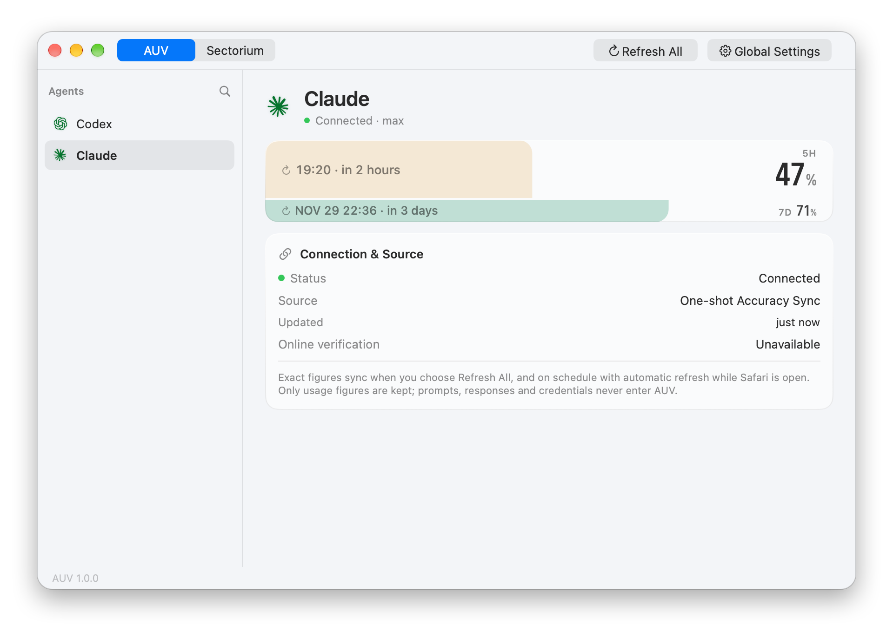
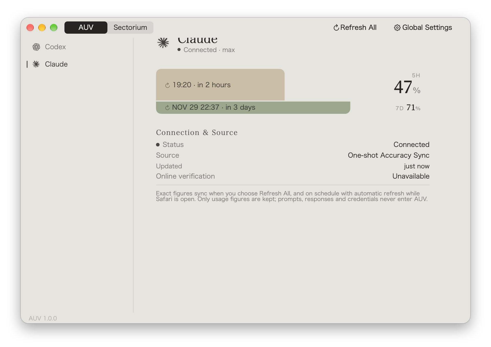
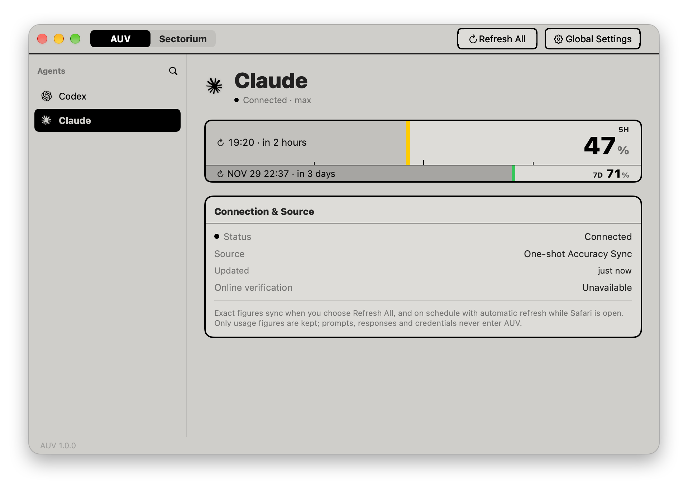
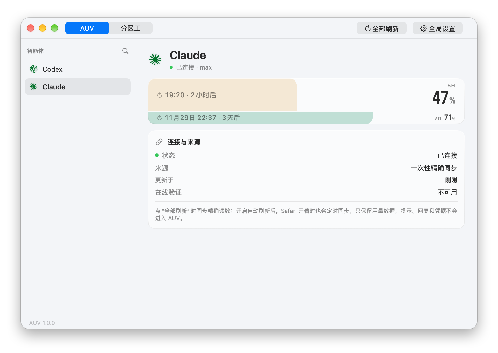
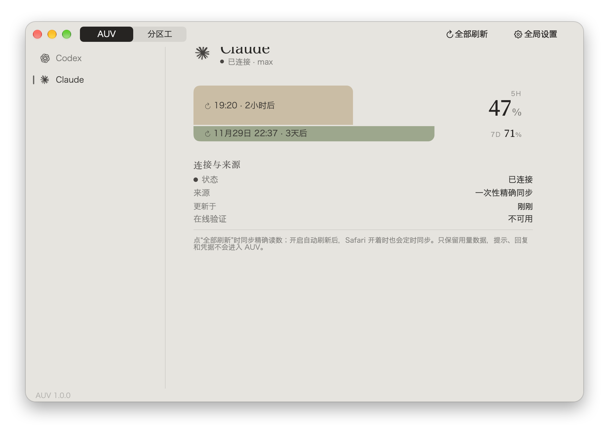
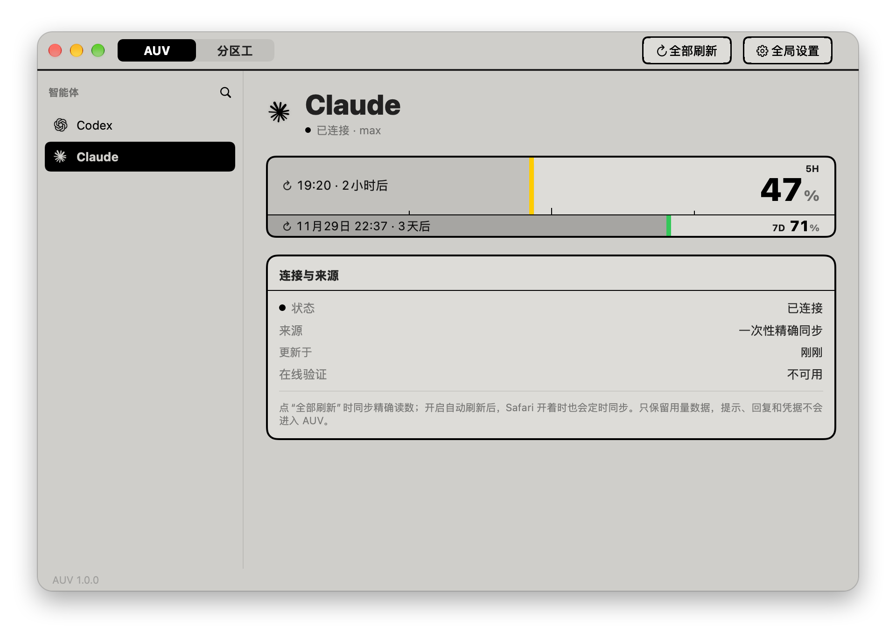

# AUV Mac 1.0.0

**Build 2026112605 · macOS 14+ · Universal for Apple silicon and Intel.**

[Download the Mac app (DMG)](https://github.com/ShaoJHe-SilkRoad/UMA/releases/download/v1.0.0/AUV_Mac_1.0.0_Universal.dmg) · [ZIP](https://github.com/ShaoJHe-SilkRoad/UMA/releases/download/v1.0.0/AUV_Mac_1.0.0_Universal.zip) · [Install or upgrade](../INSTALLATION.md#mac-installation-guide) · [Compatibility](../MAC_COMPATIBILITY.md)

| Standard | Wabi-sabi | Brutalist |
| --- | --- | --- |
|  |  |  |

## What's new

AUV 1.0 shows every agent's allowance as one usage card, adds two appearance packs, and reads Gemini.

- **One usage card everywhere.** The main window, the menu bar drop-down and the desktop assistant show the same card: the 5-hour level on top, the 7-day level beneath it, each with its reset time, and the remaining share as one large figure. Colours follow how much is left. An estimate carries "≈".
- **Agent pages in one column.** Each agent's page holds its usage card, its figures, its connection and source, and its own settings, so the separate settings sheet is gone.
- **Appearance packs.** Settings → General → Look offers **Standard**, **Wabi-sabi** and **Brutalist**. A pack changes only how AUV is drawn: type, colour, surfaces and controls across the main window, Settings, Sectorium, the drop-down and the desktop assistant. Each pack plays its own welcome sound when you choose it.
  - **Wabi-sabi:** stone and charcoal grounds, natural dyes (moss, ochre, rust), Mincho titles and space instead of boxes; an out-of-date reading fades like patina.
  - **Brutalist:** concrete grounds, 2-point ink rules and heavy figures; the tier shows as a solid block where the level ends, hollow when the reading is out of date.
- **The bar sits beside the window buttons.** The AUV / Sectorium switch, Refresh All and Global Settings are in the title bar next to the traffic lights, and the whole window is one colour. Settings works the same way.
- **A smaller desktop assistant.** The Regular card is 240 × 58 points, 80% of its former size, in every look.
- **Gemini.** Gemini's usage on gemini.google.com is read through the Safari Bridge, and it has its own card. Turn it on in Settings → Agents.
- **Antigravity is back.** Google Antigravity's allowance is read from its official command-line tool.

The Safari Bridge inside AUV is now **UMA Safari Bridge 0.15.1**. Claude's page shows **Update Safari Bridge**; choose it once after upgrading.

How usage figures are calculated is unchanged.

## Verification and limits

Package checks ran on macOS 27.2 on Apple silicon. AUV and the Safari Bridge inside it are each Developer ID signed, Apple notarized and stapled, and so is the DMG. The full test suite ran with only known, unrelated failures.

- **Not tried live:** physical Intel Macs and macOS 14/15.
- **Window minimum:** with the bar in the title bar, macOS keeps the main window at least 528 points tall.

[Windows is at 0.18.7](https://github.com/ShaoJHe-SilkRoad/UMA/releases/tag/v0.18.7-win) and is released separately.

## Download identity

- File: `AUV_Mac_1.0.0_Universal.dmg`
- Size: **18,838,603 bytes**
- SHA-256:

```text
18bf13a7a3b75777c1ffcf11126b5da08d2e633dd0508d67cc3b791cb92bb84c
```

- File: `AUV_Mac_1.0.0_Universal.zip`
- Size: **18,641,316 bytes**
- SHA-256:

```text
cfaac66aefd714bfc9f9be5f867eaad00b784536fa990ca891f17fc84b88c516
```

[Connection troubleshooting](../FIRST_INSTALL_TROUBLESHOOTING.md) · [Report a problem](https://github.com/ShaoJHe-SilkRoad/UMA/issues)

---

## 中文

**构建号 2026112605 · macOS 14 及以上 · Apple silicon / Intel 通用包。**

[下载 Mac 应用（DMG）](https://github.com/ShaoJHe-SilkRoad/UMA/releases/download/v1.0.0/AUV_Mac_1.0.0_Universal.dmg) · [ZIP](https://github.com/ShaoJHe-SilkRoad/UMA/releases/download/v1.0.0/AUV_Mac_1.0.0_Universal.zip) · [安装与升级](../INSTALLATION.md#mac-中文安装指南) · [兼容性说明](../MAC_COMPATIBILITY.md#中文)

| 标准 | 侘寂 | Brutalist |
| --- | --- | --- |
|  |  |  |

### 本版更新

AUV 1.0 用同一张用量卡片显示每个智能体的额度，新增两套外观包，并支持读取 Gemini。

- **处处同一张用量卡片。** 主窗口、菜单栏下拉面板和桌面助手显示同一张卡片：上方是 5 小时额度，下方是 7 天额度，各带重置时间，剩余比例用一个大数字显示。颜色随剩余多少变化；估算值带“≈”。
- **智能体页改为单栏。** 每个智能体的页面里依次是用量卡片、统计数字、连接与来源，以及它自己的设置；原来单独弹出的设置面板不再需要。
- **外观包。** 设置 → 通用 → 外观包，可选 **标准**、**侘寂**、**Brutalist**。外观包只改变 AUV 的样子：主窗口、设置、分区工、下拉面板和桌面助手的字体、颜色、底色与控件。选中时会播放该外观的欢迎音。
  - **侘寂：** 石色与炭色底，苔绿、赭石、铁锈等天然染色，明朝体标题，用留白代替方框；过期的读数像包浆一样变淡。
  - **Brutalist：** 混凝土底色、2pt 墨线和粗重数字；额度档位用实心色块标在用量尽头，读数过期时变为空心。
- **顶栏挪到红绿灯旁边。** “AUV / 分区工”切换、“全部刷新”和“全局设置”放进标题栏，紧挨窗口按钮，整个窗口一个颜色。设置窗口也一样。
- **桌面助手更小。** 常规卡片为 240 × 58 点，是原来的 80%，三种外观都一样。
- **Gemini。** 通过 Safari 助手读取 gemini.google.com 上的 Gemini 用量，并有自己的卡片。在 设置 → 智能体 中开启。
- **Antigravity 回归。** 通过 Google Antigravity 官方命令行工具读取其额度。

AUV 内置的 Safari 助手更新为 **UMA Safari 助手 0.15.1**。升级后 Claude 页面会显示“更新 Safari 助手”，点一次即可。

用量数值的计算方式不变。

### 验证范围与限制

包验证在 macOS 27.2 的 Apple silicon Mac 上完成。AUV 及其内置的 Safari 助手均已完成 Developer ID 签名、Apple 公证与票据装订，DMG 本身也一样。全量测试中只有已知、与本版无关的失败。

- **未实测：** Intel 实机；macOS 14/15。
- **窗口最小高度：** 顶栏放进标题栏后，macOS 要求主窗口至少 528 点高。

[Windows 版为 0.18.7](https://github.com/ShaoJHe-SilkRoad/UMA/releases/tag/v0.18.7-win)，单独发布。

### 下载文件

- 文件：`AUV_Mac_1.0.0_Universal.dmg`
- 大小：**18,838,603 字节**
- SHA-256：

```text
18bf13a7a3b75777c1ffcf11126b5da08d2e633dd0508d67cc3b791cb92bb84c
```

- 文件：`AUV_Mac_1.0.0_Universal.zip`
- 大小：**18,641,316 字节**
- SHA-256：

```text
cfaac66aefd714bfc9f9be5f867eaad00b784536fa990ca891f17fc84b88c516
```

[连接排错](../FIRST_INSTALL_TROUBLESHOOTING.md#中文) · [反馈问题](https://github.com/ShaoJHe-SilkRoad/UMA/issues)
