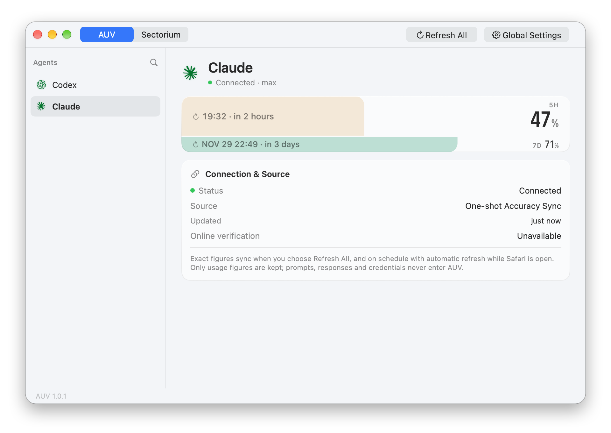
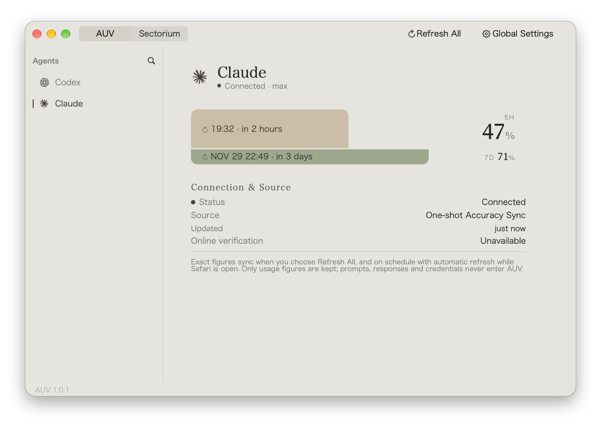
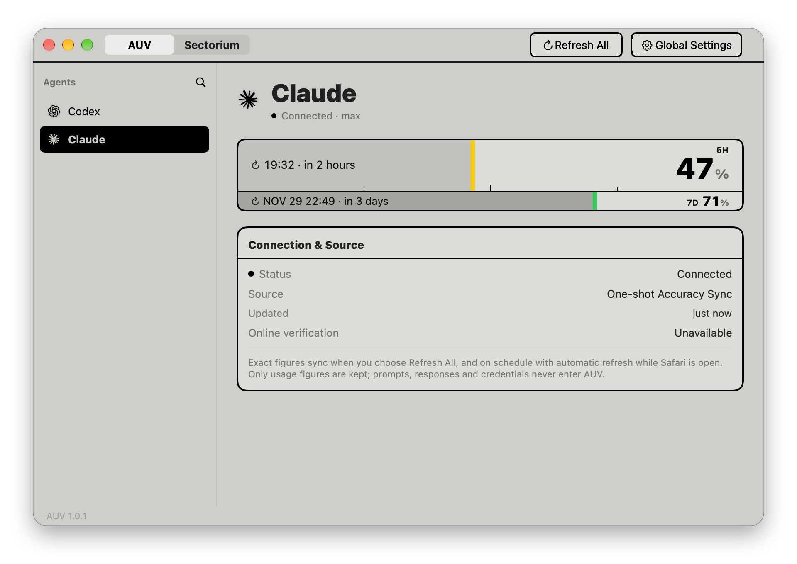
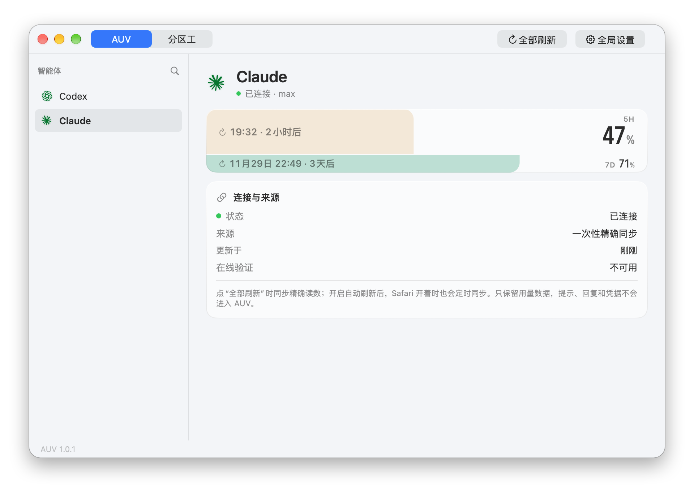
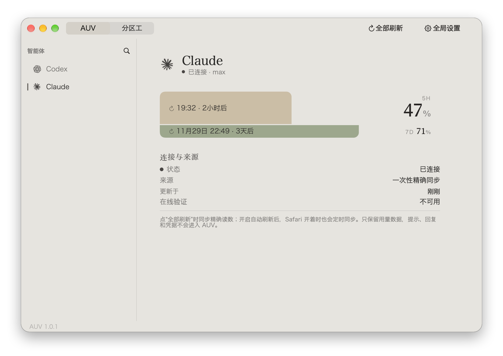
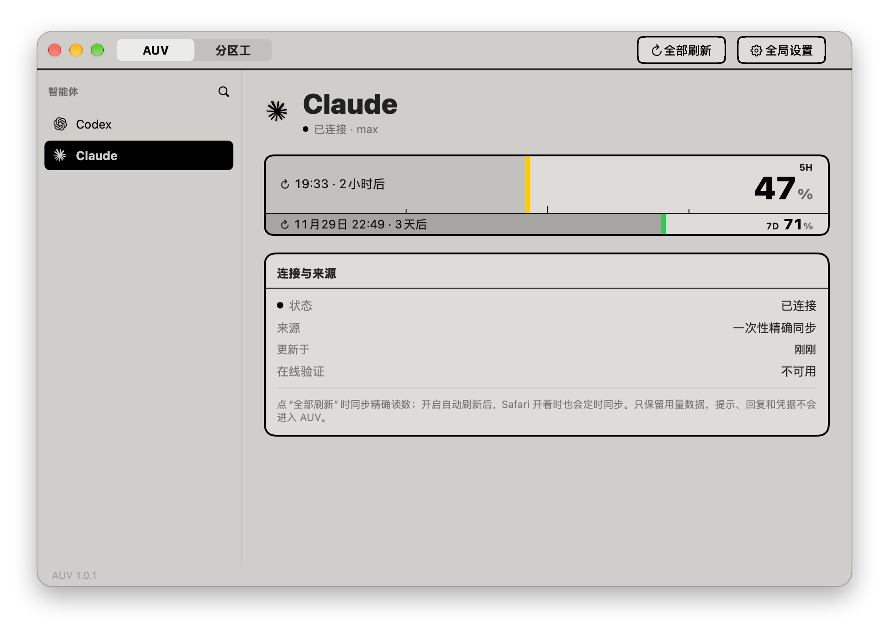

# AUV Mac 1.0.1

**Build 2026112606 · macOS 14+ · Universal for Apple silicon and Intel.**

[Download the Mac app (DMG)](https://github.com/ShaoJHe-SilkRoad/UMA/releases/download/v1.0.1/AUV_Mac_1.0.1_Universal.dmg) · [ZIP](https://github.com/ShaoJHe-SilkRoad/UMA/releases/download/v1.0.1/AUV_Mac_1.0.1_Universal.zip) · [Install or upgrade](../INSTALLATION.md#mac-installation-guide) · [Compatibility](../MAC_COMPATIBILITY.md)

| Standard | Wabi-sabi | Brutalist |
| --- | --- | --- |
|  |  |  |

## What's new

1.0.1 fixes the main window and Settings in 1.0.0. Please update if you installed 1.0.0.

- **Everything sits where it is drawn again.** In 1.0.0 the content of the main window was shifted up under the title bar: the agents list's header and each page's title were hidden, and clicks could land on the wrong control. The main window and Settings now lay out below the bar, and clicks land where you see them.

Everything else is as in [1.0.0](AUV_Mac_1.0.0.md): one usage card on every surface, the Standard, Wabi-sabi and Brutalist looks with their welcome sounds, the bar beside the window buttons, Gemini through the Safari Bridge, and Antigravity. The Safari Bridge inside AUV is **UMA Safari Bridge 0.15.1**; coming from 0.18.x, choose **Update Safari Bridge** on Claude's page once.

## Verification and limits

Package checks ran on macOS 27.2 on Apple silicon. AUV and the Safari Bridge inside it are each Developer ID signed, Apple notarized and stapled, and so is the DMG. The main window and Settings were checked on screen in a separately identified copy of this build: rows, the scan button, the bar and the settings panes sit and respond where they are drawn. The full test suite ran with only known, unrelated failures.

- **Not tried live:** full screen; physical Intel Macs and macOS 14/15.
- **Window minimum:** with the bar in the title bar, macOS keeps the main window at least 528 points tall.

[Windows is at 0.18.7](https://github.com/ShaoJHe-SilkRoad/UMA/releases/tag/v0.18.7-win) and is released separately.

## Download identity

- File: `AUV_Mac_1.0.1_Universal.dmg`
- Size: **18,837,243 bytes**
- SHA-256:

```text
a73cb885f951e871a571d0eb7211626e2c4c0330091ce79123adf00df34daa28
```

- File: `AUV_Mac_1.0.1_Universal.zip`
- Size: **18,638,096 bytes**
- SHA-256:

```text
8f9e86c81841eb60f6611344fa489ebdf79ad3418b55796f6d1e421f10c6f4b8
```

[Connection troubleshooting](../FIRST_INSTALL_TROUBLESHOOTING.md) · [Report a problem](https://github.com/ShaoJHe-SilkRoad/UMA/issues)

---

## 中文

**构建号 2026112606 · macOS 14 及以上 · Apple silicon / Intel 通用包。**

[下载 Mac 应用（DMG）](https://github.com/ShaoJHe-SilkRoad/UMA/releases/download/v1.0.1/AUV_Mac_1.0.1_Universal.dmg) · [ZIP](https://github.com/ShaoJHe-SilkRoad/UMA/releases/download/v1.0.1/AUV_Mac_1.0.1_Universal.zip) · [安装与升级](../INSTALLATION.md#mac-中文安装指南) · [兼容性说明](../MAC_COMPATIBILITY.md#中文)

| 标准 | 侘寂 | Brutalist |
| --- | --- | --- |
|  |  |  |

### 本版更新

1.0.1 修复 1.0.0 的主窗口和设置窗口。装过 1.0.0 的请更新。

- **界面和点击位置重新对齐。** 1.0.0 中主窗口的内容整体上移到标题栏下面：智能体列表的标题和各页面的标题被遮住，点击也可能落到别的控件上。现在主窗口和设置窗口都排在顶栏下方，点到哪里就是哪里。

其余与 [1.0.0](AUV_Mac_1.0.0.md#中文) 相同：处处同一张用量卡片；标准、侘寂、Brutalist 三套外观及各自的欢迎音；顶栏挪到窗口按钮旁；通过 Safari 助手读取 Gemini；Antigravity 回归。AUV 内置 **UMA Safari 助手 0.15.1**；从 0.18.x 升级后，在 Claude 页面点一次“更新 Safari 助手”。

### 验证范围与限制

包验证在 macOS 27.2 的 Apple silicon Mac 上完成。AUV 及其内置的 Safari 助手均已完成 Developer ID 签名、Apple 公证与票据装订，DMG 本身也一样。主窗口和设置窗口已用本构建的独立标识副本在屏幕上检查：列表行、扫描按钮、顶栏和各设置页的位置与点击都一致。全量测试中只有已知、与本版无关的失败。

- **未实测：** 全屏；Intel 实机；macOS 14/15。
- **窗口最小高度：** 顶栏放进标题栏后，macOS 要求主窗口至少 528 点高。

[Windows 版为 0.18.7](https://github.com/ShaoJHe-SilkRoad/UMA/releases/tag/v0.18.7-win)，单独发布。

### 下载文件

- 文件：`AUV_Mac_1.0.1_Universal.dmg`
- 大小：**18,837,243 字节**
- SHA-256：

```text
a73cb885f951e871a571d0eb7211626e2c4c0330091ce79123adf00df34daa28
```

- 文件：`AUV_Mac_1.0.1_Universal.zip`
- 大小：**18,638,096 字节**
- SHA-256：

```text
8f9e86c81841eb60f6611344fa489ebdf79ad3418b55796f6d1e421f10c6f4b8
```

[连接排错](../FIRST_INSTALL_TROUBLESHOOTING.md#中文) · [反馈问题](https://github.com/ShaoJHe-SilkRoad/UMA/issues)
